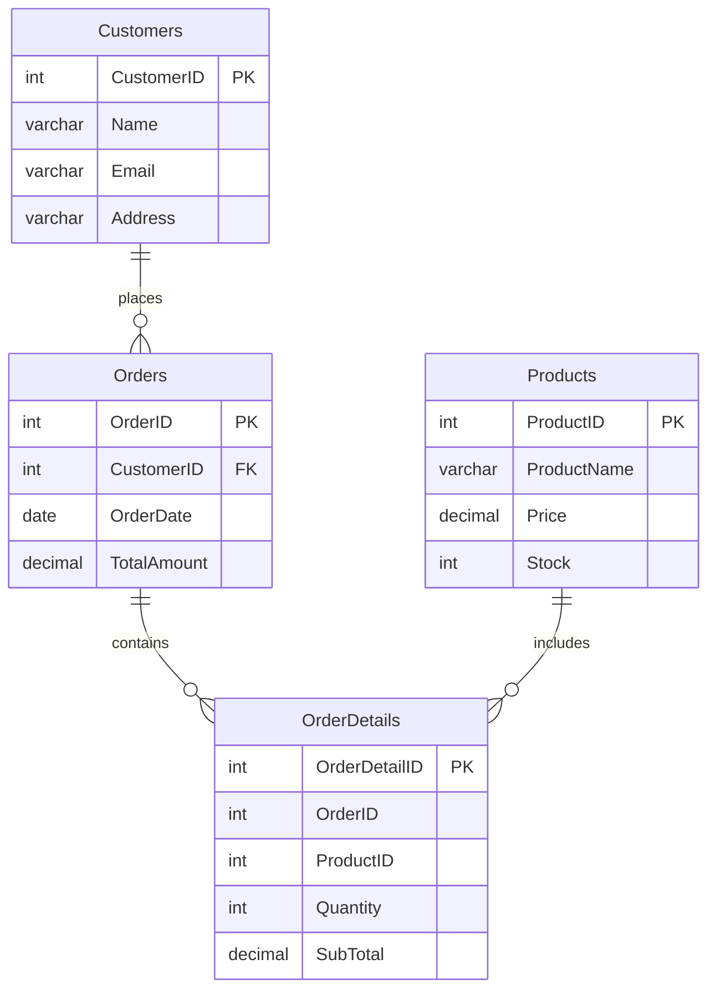

# 🚀 DATADIGGER – Customer & Order Management System

## 📌 About The Project

**DATADIGGER** is a MySQL-based database management project designed to demonstrate essential SQL operations and relational database concepts.

This project provides a structured way to manage customer information, track orders, maintain product inventories, and analyze sales data using SQL queries.

It is an excellent beginner-friendly project for learning database management and practicing real-world SQL operations.

## ✨ Key Features

- 👥 **Customer Management** – Insert, update, delete, and retrieve customer records.
- 📦 **Order Management** – Manage customer orders and track order dates.
- 🛍️ **Product Management** – Maintain product prices and stock quantities.
- 🧾 **Order Details** – Track products, quantities, and subtotals.
- 🔗 **Foreign Key Relationship** – Connect orders with customers.
- ⚡ **Cascade Delete** – Automatically delete associated orders when a customer is deleted.
- 📊 **Sales Analysis** – Calculate total revenue, highest orders, lowest orders, and average order value.
- 🔍 **Data Filtering** – Use WHERE, BETWEEN, ORDER BY, and LIMIT.

## 🛠️ Technologies Used

| Technology | Purpose |
|---|---|
| MySQL | Database Management |
| SQL | Query Language |
| MySQL Workbench | Database Development |
| GitHub | Project Documentation |

## 🗂️ Database Structure

The project contains four main tables:

### 1. Customers
Stores customer information.

| Column | Data Type | Description |
|---|---|---|
| CustomerID | INT | Primary Key |
| Name | VARCHAR(100) | Customer Name |
| Email | VARCHAR(100) | Email Address |
| Address | VARCHAR(255) | Customer Address |

### 2. Orders
Stores customer order information.

| Column | Data Type | Description |
|---|---|---|
| OrderID | INT | Primary Key |
| CustomerID | INT | Foreign Key |
| OrderDate | DATE | Order Date |
| TotalAmount | DECIMAL(10,2) | Total Order Amount |

### 3. Products
Stores product and inventory information.

| Column | Data Type | Description |
|---|---|---|
| ProductID | INT | Primary Key |
| ProductName | VARCHAR(100) | Product Name |
| Price | DECIMAL(10,2) | Product Price |
| Stock | INT | Available Stock |

### 4. OrderDetails
Stores individual products associated with orders.

| Column | Data Type | Description |
|---|---|---|
| OrderDetailID | INT | Primary Key |
| OrderID | INT | Order Reference |
| ProductID | INT | Product Reference |
| Quantity | INT | Product Quantity |
| SubTotal | DECIMAL(10,2) | Subtotal Amount |

## 🔗 Database Relationship



## 💻 SQL Concepts Covered

This project demonstrates the following SQL concepts:

- CREATE DATABASE
- CREATE TABLE
- INSERT INTO
- SELECT
- UPDATE
- DELETE
- WHERE
- ORDER BY
- BETWEEN
- MAX(), MIN(), AVG()
- SUM(), COUNT()
- INNER JOIN
- GROUP BY
- LIMIT
- PRIMARY KEY
- FOREIGN KEY
- AUTO_INCREMENT
- ON DELETE CASCADE

## 🚀 How To Run This Project

### Step 1: Install MySQL

Download and install:

[MySQL Community Server](https://dev.mysql.com/downloads/mysql/)

[MySQL Workbench](https://dev.mysql.com/downloads/workbench/)

### Step 2: Open MySQL Workbench

Connect to your MySQL server and open a new SQL query tab.

### Step 3: Create The Database

```sql
CREATE DATABASE DATADIGGER;
USE DATADIGGER;
```

### Step 4: Execute SQL Queries

Run the SQL statements in the following order:

1. Create Customers table.
2. Insert customer records.
3. Create Orders table.
4. Insert order records.
5. Create Products table.
6. Insert product records.
7. Create OrderDetails table.
8. Insert order details.
9. Execute SELECT, UPDATE, DELETE, JOIN, and aggregate queries.

### Step 5: Verify Results

Run:

```sql
SHOW TABLES;
SELECT * FROM Customers;
SELECT * FROM Orders;
SELECT * FROM Products;
SELECT * FROM OrderDetails;
```

## 📊 Example SQL Queries

### 1. Find Customer Orders

```sql
SELECT * FROM Orders
WHERE CustomerID = 1;
```

### 2. Calculate Total Revenue

```sql
SELECT SUM(SubTotal) AS TotalRevenue
FROM OrderDetails;
```

### 3. Find The Most Expensive Product

```sql
SELECT MAX(Price) AS MostExpensive
FROM Products;
```

### 4. Find Top 3 Most Ordered Products

```sql
SELECT p.ProductID, p.ProductName,
       SUM(od.Quantity) AS TotalOrdered
FROM OrderDetails od
INNER JOIN Products p
ON od.ProductID = p.ProductID
GROUP BY p.ProductID, p.ProductName
ORDER BY TotalOrdered DESC, p.ProductID
LIMIT 3;
```

## 🎥 Video Explanation

Watch the complete project explanation and SQL implementation here:

**Video Topics:**
- Database creation
- Table creation and relationships
- Inserting sample records
- UPDATE and DELETE operations
- JOIN queries
- Aggregate functions
- Final project demonstration

> Replace `YOUR_YOUTUBE_VIDEO_LINK` with your actual YouTube video URL.

## 🎯 Learning Objectives

By completing this project, I practiced:

- Understanding relational databases.
- Writing SQL queries.
- Managing structured data.
- Creating relationships between tables.
- Applying aggregate functions.
- Performing data analysis using JOIN operations.

## 🔮 Future Improvements

- Add user authentication.
- Implement advanced sales reports.
- Create a Python-based interface.
- Add a dashboard for data visualization.
- Connect the database to a web application.

## 👨‍💻 Author

**DATADIGGER**

MySQL Database Management Project

📍 Rajkot, Gujarat, India

---

<p align="center">
  <b>⭐ If you like this project, give it a star on GitHub!</b>
  <br><br>
  Made with ❤️ using MySQL
</p>
